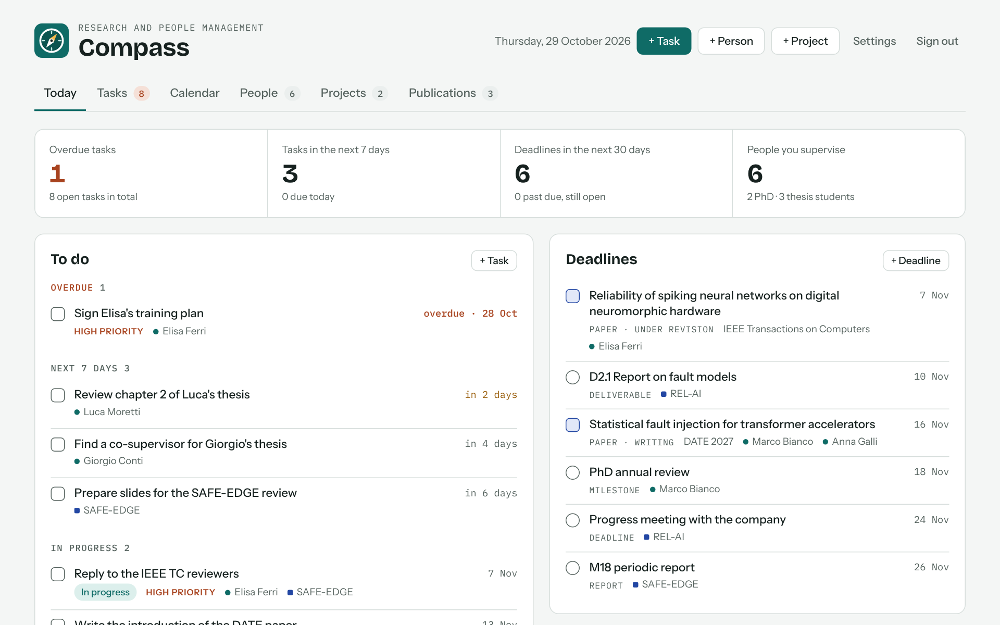
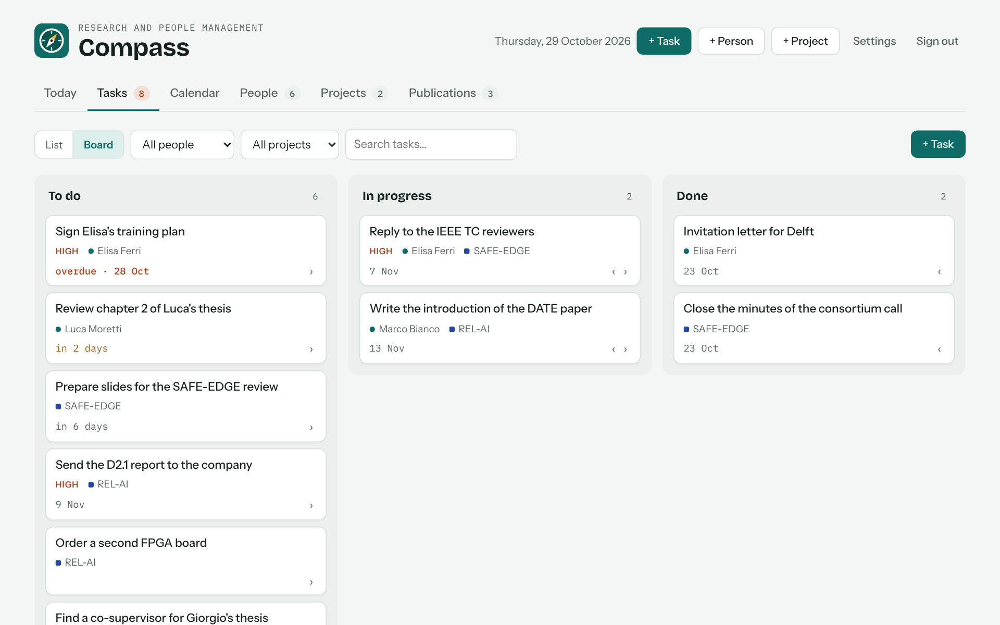
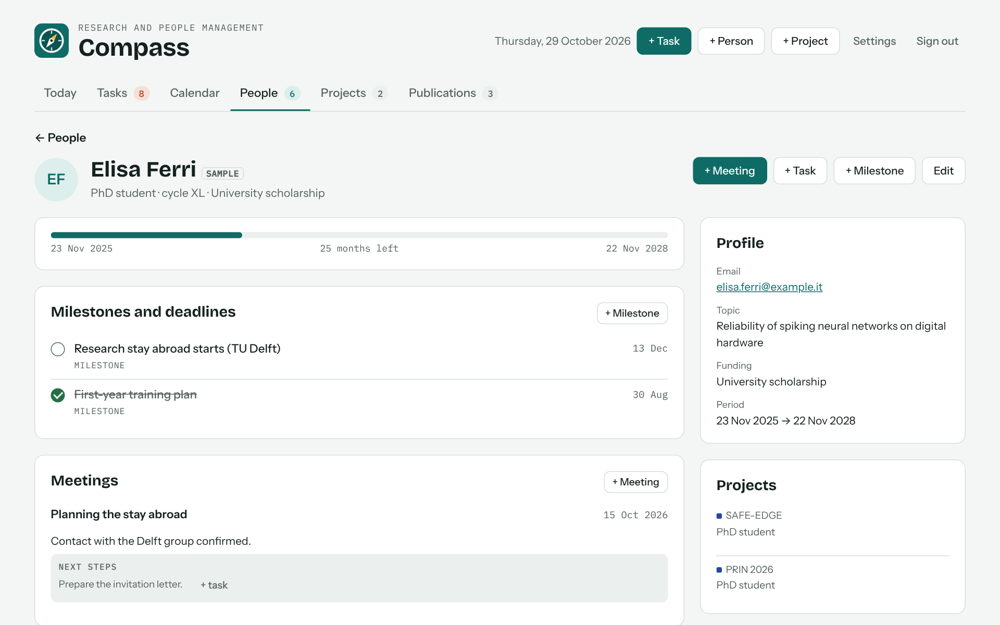
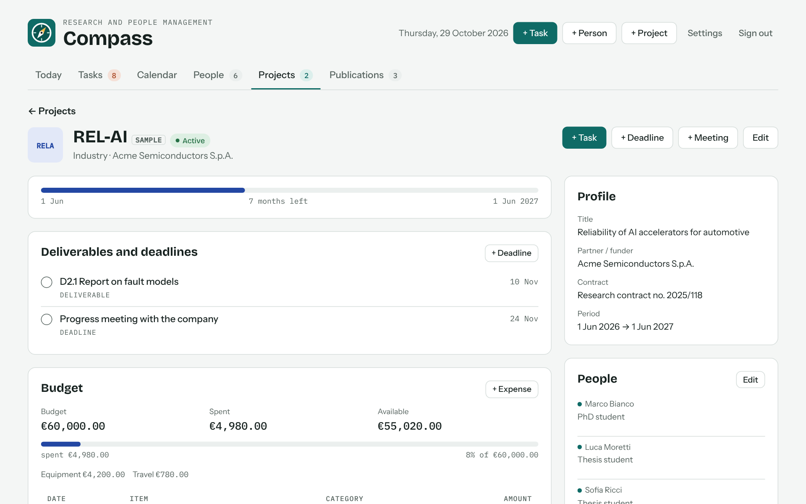

<p align="center"></p>

# Compass — research and people management

A local app for academics who supervise thesis and PhD students and run research and industry projects:
people with milestones, meetings and publications; projects (industry, European, national…) with
deliverables, budget, expenses, contacts and people involved; tasks as a list, a board and a calendar
(month or week). Single user, data in one SQLite file on the PC.

Everyday instructions are in `README.txt`.

<table>
  <tr>
    <td></td>
    <td></td>
  </tr>
  <tr>
    <td align="center"><b>Today</b>: what is overdue, what is next</td>
    <td align="center"><b>Tasks</b>: list or board</td>
  </tr>
  <tr>
    <td></td>
    <td></td>
  </tr>
  <tr>
    <td align="center"><b>People</b>: milestones, meeting notes, publications</td>
    <td align="center"><b>Projects</b>: deliverables, budget, people, contacts</td>
  </tr>
</table>

<sub>Screenshots use the built-in sample data: names, projects and emails are made up.</sub>

## Running it

- **Windows**: `Install Compass.bat` (Python ≥ 3.10), then the Compass icon on the desktop.
- **Command line** (any OS): `pip install -r requirements.txt` and `python compass_launcher.pyw`
  (or `--no-window`). It opens on http://127.0.0.1:8797.

Data lives in `%LOCALAPPDATA%\Compass` (on Linux/macOS `~/.local/share/Compass`). On first start, data from
earlier versions of the app (Bussola, GRiP) is imported automatically.

## Layout

```
app.py                 Flask API: sign-in, entities, .ics calendar, full export/import
db.py                  SQLite schema
examples.py            sample data
compass_launcher.pyw   local launcher: waitress server on 127.0.0.1, Tk window, backups
static/                UI (HTML, CSS, dependency-free JavaScript; fonts served locally)
tests/                 python tests/smoke_test.py
```

## API

Every request that changes data needs the `X-Compass: 1` header (CSRF protection).

- `GET /api/state` — all data
- `POST /api/<entity>` · `PATCH /api/<entity>/<id>` · `DELETE /api/<entity>/<id>`
  with entity in `people`, `projects`, `contacts`, `expenses`, `deadlines`, `meetings`, `pubs`, `tasks`
- `GET /api/calendar.ics` — open deadlines and tasks
- `GET /api/archive` / `POST /api/archive` — export / import everything (.compass)
- `POST /api/examples` / `DELETE /api/examples` — sample data

Amounts are stored in cents (`budget_cents`, `amount_cents`); input also accepts text such as `12,500.50`
or `12.500,50`. Enumerated values (person kind, project status…) keep their original Italian keys in the
database for compatibility with earlier versions; the UI shows English labels.

## Security

Listens on 127.0.0.1 only. Passwords hashed with scrypt, lock-out after 5 failed attempts, HttpOnly session
cookie, strict Content-Security-Policy, anti-CSRF header. The exported .compass file holds personal data:
treat it accordingly.

---

Compass was built by Annachiara Ruospo with the help of Claude (Anthropic).
